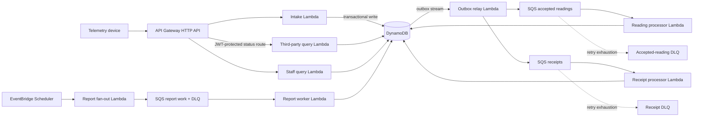

# AWS Serverless Fleet Telemetry

A Python 3.11 fleet telemetry service and Terraform deployment for ingesting
vehicle readings, processing alerts, serving authorized queries, and producing
daily reports.

## Architecture



The intake flow commits canonical telemetry, device sequence/idempotency state,
and notification intent together in DynamoDB. DynamoDB Streams drive the
outbox relay, which publishes to SQS for asynchronous processing. SQS queues
have dead-letter queues. EventBridge Scheduler starts the daily report
workflow. DynamoDB and SQS use KMS encryption, and the HTTP API includes a
Cognito JWT authorizer for the external status route.

Terraform provisions the API, Lambda functions, queues, DynamoDB tables,
streams, scheduler, Cognito resources, KMS key, monitoring, and backups.
GitLab CI/CD runs Python and Terraform checks, packages the Lambda code, and
uses GitLab OIDC for AWS access. Staging applies from the default branch;
production apply has a manual gate.

## Repository layout

```text
src/fleet_telemetry/   Python application and Lambda handlers
tests/                 Unit, integration, and infrastructure tests
infra/                 Terraform root module and AWS service modules
scripts/               Bootstrap and packaging utilities
docs/                  Architecture and report-format documentation
.gitlab-ci.yml         GitLab validation, build, and deployment pipeline
payload.json           Example Lambda invocation payload
```

## Run the tests

Requires Python 3.11 or later.

```sh
python -m pip install -e ".[dev]"
pytest
```

The tests use local adapters and do not require AWS credentials or deployed
resources.

## Validate Terraform

Requires Terraform 1.5 or later.

```sh
terraform -chdir=infra fmt -check -recursive
terraform -chdir=infra init -backend=false
terraform -chdir=infra validate
```

The environment variable files use the example GitLab path
`example-org/aws-fleet-telemetry`; replace it with the path of your own GitLab
project before configuring OIDC. Configure AWS account and state-backend
settings in the CI environment rather than committing account-specific values
or credentials.

> **Before deploying:** review the IAM permissions in the OIDC bootstrap and
> Terraform configuration, restrict trust to protected refs, and apply
> least-privilege policies for your account.
